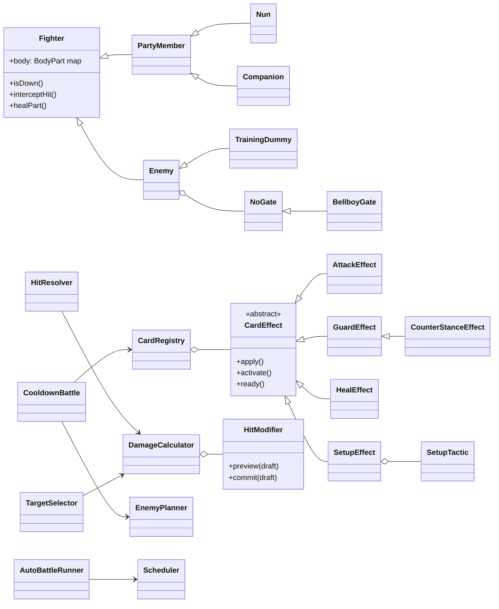

# 루치아: 빈콜리의 등불 코드 구조

웹판을 객체지향 4대 특성(캡슐화·추상화·상속·다형성)과 SOLID 원칙에 맞춰 나눈 구조다. 게임 규칙은 [DESIGN.md](DESIGN.md)를 따르고, 이 문서는 코드를 어떻게 나눴는지만 다룬다. Godot판은 범위에 넣지 않았다.

## 1. 진행 상황

리팩터링 전에는 `index.html` 4,745줄 안에 스크립트가 한 블록으로 들어 있었다. 최상위 함수가 314개였고, 전역 `game` 하나와 전역 변수 11개가 모든 상태를 들고 있었다. 지금은 게임 규칙이 `src/` 아래 모듈과 클래스로 나뉘어 있다.

| 단계 | 내용 | 상태 |
| --- | --- | --- |
| 0 | 스크립트를 `src/legacy.js`로 분리, ES 모듈 진입점 `src/main.js` | 완료 |
| 1 | 데이터 표를 `src/data/`로 분리 | 완료 |
| 2 | `BodyPart`, `Fighter` 계층 | 완료 |
| 3 | `DamageCalculator`와 `HitModifier` 파이프라인, 벨보이 철문 | 완료 |
| 4 | `CardEffect`와 `CardRegistry`. 카드 효과 `switch` 제거 | 완료 |
| 5 | `CooldownBattle`, `EnemyPlanner`, `AutoBattleRunner`, `Scheduler` | 완료 |
| 6 | 지도, 표적, 일행, 장착, 영입, 보상, 이동, 상점, 판 생성, 이벤트 기록 | 완료 |
| 7 | 조립을 모듈로(`createGameServices`), 원화 좌표표를 `src/presentation/`으로, 도메인 단위 테스트 | 완료 |
| 8 | 화면 분리: `legacy.js`를 `src/game-api.js`와 `src/ui/` 12개 파일로 나누고, 상태를 가진 화면 요소를 클래스로 | 완료 |
| 9 | 테스트·도구를 새 API로 이전, 전역 API 제거 | 남음(5절) |

단계마다 아래 기준선이 리팩터링 전과 같은지 확인했다.

- 웹판 테스트 94개
- `first-stage-balance`(기본, `--ablate`, `--sweep`), `archer-qa`, `reward-simulation` 출력
- Godot판 `sync-web-data.mjs`로 만든 데이터와 `bake-combat-audio.mjs`로 구운 효과음

여기에 도메인 단위 테스트 8개를 새로 더했다([tests/domain.test.mjs](tests/domain.test.mjs)). 클래스별 역할은 [CLASSES.md](CLASSES.md)에 있다.

## 2. 구조

```
src/
  main.js                  진입점(모듈). CP를 전역에 넣고 scriptOrder 순서대로 화면 스크립트를 불러온다.
  scriptOrder.js           화면 스크립트 로드 순서(브라우저와 테스트가 함께 쓴다)
  bridge.js                화면 스크립트가 쓰는 모듈 목록(CP)
  game-api.js              데이터·규칙 객체 연결과 예전 전역 API(테스트·QA·Godot 도구가 호출)
  ui/                      화면(일반 스크립트, 같은 전역 범위)
    art.js                 스프라이트 경로, 원화 미리 불러오기
    hud.js body-panel.js skill-cards.js map.js rooms.js   상태 없는 HTML 템플릿 함수
    render.js              GameScreen, Screen 5종, PursuitHud, QaPanel, AutoBattleControls
    combat-presenter.js    CombatPresenter, ActorSprites, HitEffects
    audio.js               WebAudioSynth, CombatAudio
    opening.js codex.js    OpeningView, CodexView
    input.js               FormationDrag, MapTravel, 입력 연결. 마지막에 첫 화면을 그린다.
  data/                    선언형 데이터. 호출할 때마다 새 객체를 만든다.
  presentation/            artData.js(원화 좌표표), hit-fx.js·hit-fx.css(타격 단계 연출), ui-polish.css(출전 막대·일시정지 표시·좁은 화면 상단 버튼)
  application/
    createGameServices.js  규칙 객체를 만들고 연결하는 유일한 곳(조립 루트)
    AutoBattleRunner.js    자동 전투 타이머(일시정지·배속·타이머 하나)
  infrastructure/
    TimeoutScheduler.js    setTimeout을 Scheduler 계약으로 감싼다.
  domain/                  DOM·타이머·Math.random을 쓰지 않는 게임 규칙
    body/BodyPart.js
    actors/                Fighter, PartyMember·Nun·Companion, Enemy·TrainingDummy, FighterFactory
    combat/                DamageCalculator, HitDraft, hitModifiers, HitResolver, gates,
                           EnemyPlanner, TargetSelector, CooldownBattle
    cards/                 CardEffect, CardRegistry, effects/(Attack, Guard·CounterStance, Heal, Setup)
    party/                 Party, Loadout, SynergyBook
    run/                   RunFactory, Journey, Recruitment, RewardDraft, BlackMarket
    map/MapGenerator.js
    events/StateEventSink.js
    random.js
```

의존 방향은 `ui → game-api.js → application → domain`이다. `domain`은 `data`가 만든 값만 생성자로 받고 다른 계층을 import하지 않는다. 판 상태(`game`)는 화면과 도구가 직접 읽으므로 평범한 객체로 두고, 규칙 객체는 상태를 매개변수로 받는다.



## 3. 객체지향 4대 특성

| 특성 | 어디에 | 내용 |
| --- | --- | --- |
| 캡슐화 | [BodyPart](src/domain/body/BodyPart.js) | 내구도·가드는 private 필드에 두고 setter가 0 아래로 내려가지 않게 막는다. 가드는 `raiseGuard`로 큰 값만 남긴다. |
| 캡슐화 | [Fighter](src/domain/actors/Fighter.js) | "부위 회복량만큼 전체 체력 회복", "배 상태에 따른 회복량", "결손 시 쓰러짐"을 객체가 지킨다. |
| 캡슐화 | [AutoBattleRunner](src/application/AutoBattleRunner.js) | 예전 전역 `autoPaused`·`autoSpeed`·`autoTimer`를 가진다. 전역 이름은 이 객체를 읽는 접근자로만 남겼다. |
| 추상화 | [CardEffect](src/domain/cards/CardEffect.js), [HitModifier](src/domain/combat/hitModifiers.js), [StateEventSink](src/domain/events/StateEventSink.js), Scheduler | 호출하는 쪽은 `apply/activate/ready`, `preview/commit`, `emit/log`, `after/cancel` 계약만 안다. |
| 상속 | `Fighter → PartyMember → Nun·Companion`, `Fighter → Enemy → TrainingDummy`, `GuardEffect → CounterStanceEffect` | 행동이 다를 때만 상속하고 두 단계를 넘기지 않는다. 대원 종류(간수·궁수 등)는 데이터로 구분한다. |
| 다형성 | [CardRegistry](src/domain/cards/CardRegistry.js) | effect 키로 효과 객체를 찾아 같은 메시지를 보낸다. 예전 `applyCard`의 `switch`와 `executePartySkill`의 분기가 없어졌다. |
| 다형성 | [Enemy](src/domain/actors/Enemy.js)·[gates](src/domain/combat/gates.js) | 모든 전투원이 `interceptHit`을 가진다. 벨보이 철문은 `BellboyGate`, 다른 적은 `NoGate`가 답한다. |
| 다형성 | [SetupEffect](src/domain/cards/effects/SetupEffect.js) | 설치형 전술 5종(가로막기, 가드 벗기기, 조준, 약화, 기세)이 각자 `SetupTactic`이다. |

벨보이는 상속 대신 조합을 썼다. QA 훈련장에서는 벨보이도 `TrainingDummy`가 되는데, 철문은 그대로 있어야 한다. `Bellboy` 하위 클래스로 만들면 두 성질을 함께 가질 수 없다.

## 4. SOLID

| 원칙 | 적용 |
| --- | --- |
| S | 예전 `start()`는 판 생성(`RunFactory`), 지도(`MapGenerator`), 화면 정리(game-api.js)로 나뉘었다. 피해 계산(`DamageCalculator`)과 적용(`HitResolver`), 전투 진행(`CooldownBattle`)과 타이머(`AutoBattleRunner`)도 분리했다. |
| O | 피해 보정 8종이 각각 클래스이고, 순서는 `createHitModifiers`의 목록 하나로 정한다. 새 카드 효과는 `CardRegistry.register`로 추가한다. 단위 테스트가 호출부를 바꾸지 않고 새 효과를 등록해 확인한다. |
| L | `TrainingDummy`는 `isDown()`이 항상 false이고, 머리를 잃으면 `reviveIfHeadLost()`로 회복한다. 전투 루프는 `infinite` 플래그를 보지 않는다. `NoGate`는 `BellboyGate`와 같은 계약을 지키되 아무것도 막지 않는다. |
| I | 규칙 객체는 필요한 협력자만 생성자로 받는다(예: `EnemyPlanner`는 카드와 `Party`만). 화면용 읽기 전용 뷰(`BattleView`)는 아직 없다. |
| D | 도메인은 `Scheduler`, `StateEventSink`, 시드 난수를 주입받는다. 테스트는 `ManualScheduler`를 넣어 타이머 없이 검사한다. 객체는 [createGameServices](src/application/createGameServices.js)에서만 만든다. |

`preview`(상태를 바꾸지 않는 계산)와 `commit`(보너스 소모)을 나눠서 AGENTS.md 규칙을 구조로 지킨다. 그 규칙은 "자동 표적 선택과 실제 타격은 같은 피해 계산을 쓰고, 비교할 때 상태를 바꾸지 않는다"이다. `TargetSelector`는 후보 부위마다 `DamageCalculator.preview`를 부른다.

## 5. 남긴 것과 남은 작업

### 교체 지점(seams)

`first-stage-balance.mjs --ablate`는 옛 규칙의 효과를 따로 재려고 전역 함수 5개를 옛 규칙으로 바꿔 끼운다. 대상은 `timedAttackTarget`, `readyTimedSkill`, `executePartySkill`, `applyCard`, `skillRewardOptions`이다. 규칙 객체는 이 다섯 곳만 `seams`를 거쳐 부른다. game-api.js는 seams를 전역 이름으로 연결하고, 모듈만 쓰면 현재 규칙이 기본값으로 들어간다. 그 밖의 협력은 객체끼리 직접 참조한다.

### 화면 분리(8단계)

화면 코드는 책임별 파일로 나눴다. 화면 요소 중 상태를 가진 것만 클래스로 만들었다.

- **오프닝·도감:** 단계, 선택 탭
- **대열 끌기·지도 이동:** 끌기 상태, 이동 연출
- **전투 연출:** 재생 중 타임라인
- **효과음:** 장치, 켜고 끈 상태
- **추격 표시:** 직전 도망 여유
- **QA 도구:** 열림 상태

`render()`는 `GameScreen`이 맡는다. `GameScreen`은 `game.phase`로 `Screen`을 골라 무대를 맡긴다.

상태 없이 값을 받아 HTML을 돌려주는 템플릿 함수(`bodyPanel`, `prepPanel` 등)는 함수로 남겼다. 클래스로 감싸도 얻는 것이 없기 때문이다.

화면 클래스의 메서드 본문은 다른 함수를 예전 전역 이름으로 부른다. 테스트가 `render`, `showImpact`, `layoutCombatHud` 같은 이름을 바꿔 넣어 연출을 검사하기 때문이다. 화면 클래스는 `document`를 생성자로 받지 않고 전역에서 쓴다.

### 전역 API가 아직 있는 이유

웹판 테스트, QA 스크립트, Godot 스크립트가 전역 이름 174개를 문자열 코드로 직접 부르거나 덮어쓴다. 그래서 다음 두 가지를 남겼다.

- **위임 함수:** `game-api.js`와 각 화면 파일 끝의 한 줄짜리 함수다.
- **값 접근자:** `autoPaused`, `combatPresentation`, `routeTravel`, `codexMember`, `audioContext` 등이다.

### 남은 작업

1. **테스트와 도구 이전.** 테스트 94개와 QA 스크립트 3개를 `createGameServices` 기준으로 옮긴다. `--ablate`는 `seams` 옵션으로 옛 규칙을 넘긴다.
2. **Godot 스크립트.** `sync-web-data.mjs`와 `compare-*.mjs`는 웹판 전역 이름을 읽는다. 웹판에 `exportWebData()`를 만들고 Godot 스크립트가 그것을 import하게 바꾼다. `compare-*.mjs` 4개는 Godot 4.7.2로 돌려 모두 통과했다(78ed0ae 기준).
3. 1~2가 끝나면 위임 함수와 값 접근자, `bridge.js`를 지운다. 그다음 화면 클래스가 `document`와 규칙 객체를 생성자로 받게 바꾼다.

## 6. 지키는 것

- **결정성.** 도메인은 `Math.random`을 직접 부르지 않는다. 보상과 지도는 `seededRandom`, 판 시드는 game-api.js의 `newRunSeed`가 만든다.
- **데이터는 데이터로.** 카드 60종 이상, 적, 동료, 지도는 `src/data/`의 객체다. 동작이 다른 효과만 클래스로 만든다.
- **판마다 새 데이터.** `createGameData()`와 `createArtData()`는 호출할 때마다 새 객체를 만든다. 밸런스 도구가 판마다 값을 바꿔도 서로 섞이지 않는다.
- **DI 컨테이너는 쓰지 않는다.** 조립은 `createGameServices`에서 `new`로 한다.

## 7. 실행과 검증

ES 모듈을 쓰므로 로컬 서버가 필요하다. 저장소 루트에서 다음 명령을 실행한 뒤 `http://127.0.0.1:8000/prototypes/collapsed-passage/`를 연다. 파일을 더블클릭해서 열면 화면 위쪽에 안내 문구가 나온다.

```powershell
python -m http.server 8000 --bind 127.0.0.1
```

검증은 이 폴더에서 한다.

```powershell
node --test tests/*.test.mjs
```

`tests/helpers/game-engine.mjs`는 `scriptOrder` 순서대로 화면 스크립트를 이어 붙여 `vm`에서 실행하고 `CP`를 넣는다. 예전 단일 `index.html`을 넘겨도 동작하므로, `reward-simulation.mjs --baseline`으로 리팩터링 전후 보상 분포를 비교할 수 있다.
